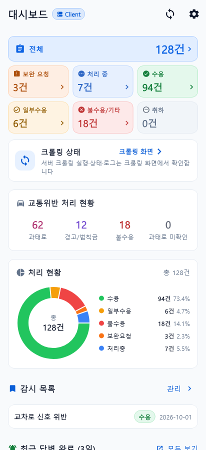
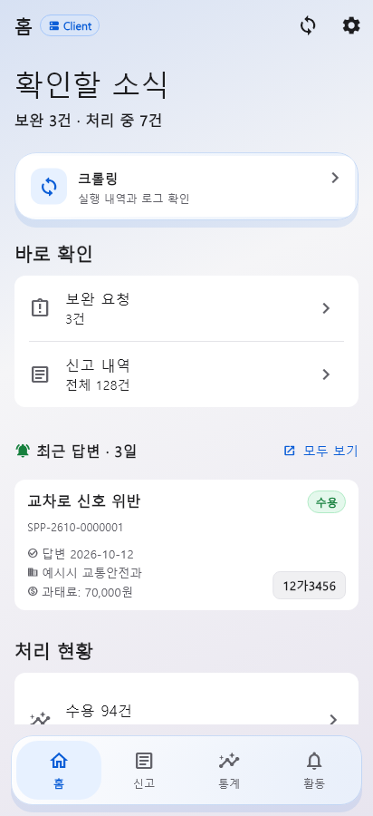
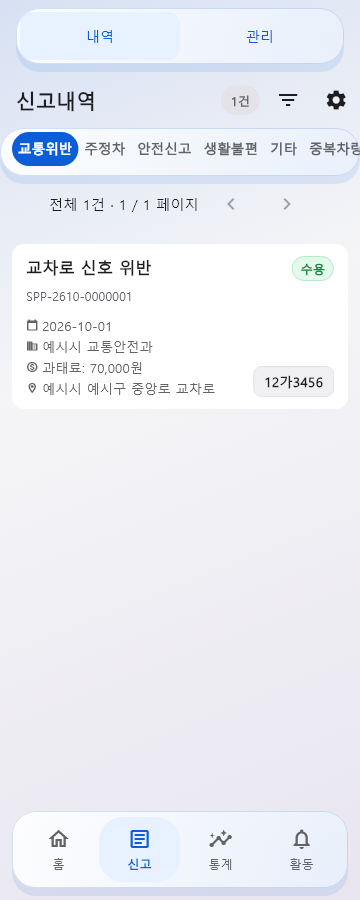
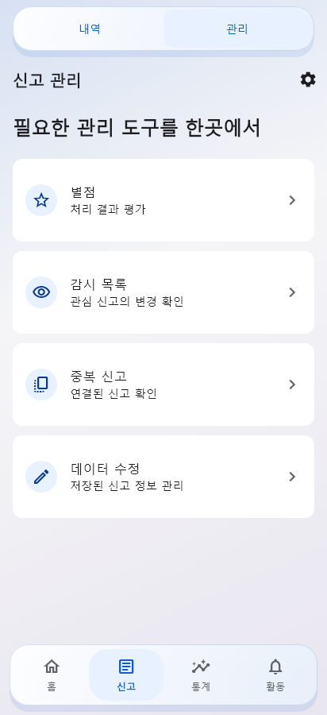
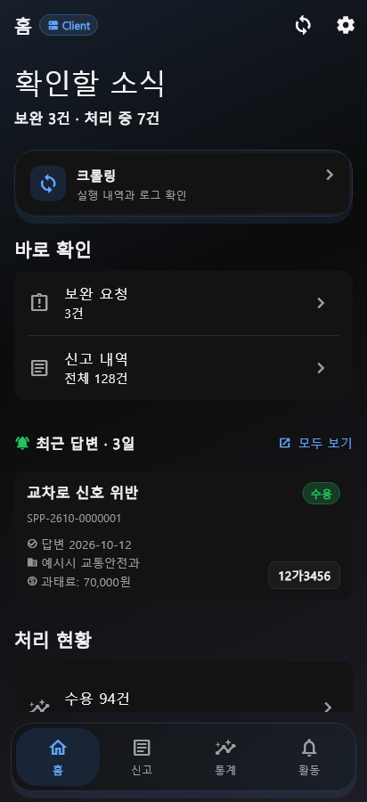
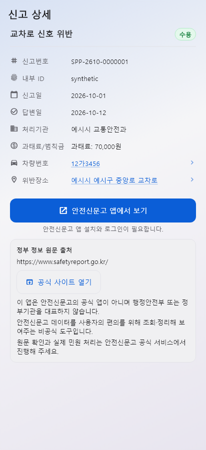
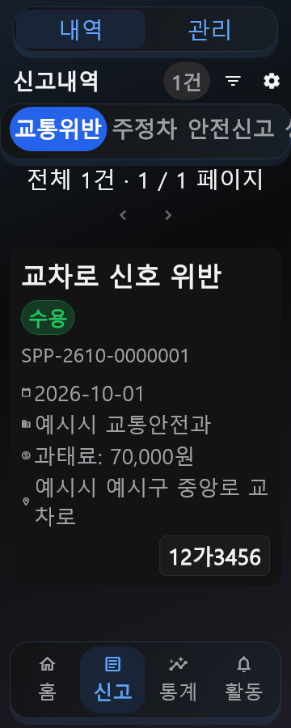
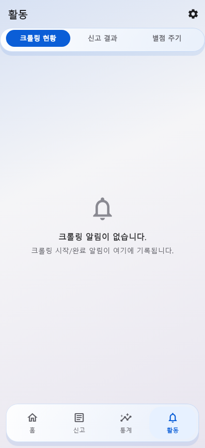

# Liquid UI and navigation overhaul

Base `64d440f0a8022cbcb49928c08ed8e18381a9e7fc`; local branch `ui/neutral-refresh`. Uncommitted, reviewable changes; no publishing or production-data changes.

## Delivered

- Four destinations: 홈 / 신고 / 통계 / 활동. Floating dock on phones; scrollable rail at 700dp and above. Dock hides for keyboard and selection; Android Back still cancels selection before returning Home.
- Reports has 내역 / 관리. All six report categories stay intact. Rating, watchlist, duplicates and data editing open as individual management pages. Existing native IDs 0–6 and management subtabs 0–3 retain their meaning.
- Home prioritizes sync/crawl, supplementation and recent answers. Original status filters and charts remain in 처리 현황; 통계 보기 opens Insights. Reports and watchlist entry points remain available.
- Full-height report detail with Back, existing metadata, attachments and official-source notices. Existing duplicate detail and search remain sheets.
- Blue/lilac ambient backgrounds, bounded glass controls, solid report surfaces, shared tabs and floating selection actions. Settings, onboarding, recovery, maps and other routes inherit the global canvas and theme; their individual flows remain intact.
- Saved glass preference and opaque high-contrast fallback; reduced-motion dock selection, setup transitions and sync indicator. Concise Korean labels and wrapping support links.
- Fixed management deep links overwriting Activity's preferred filter. Fixed a dashboard post-frame callback accessing context after unmount. Pending management/history requests now respect the latest destination.
- Design specification, project rules, feature matrix and changelog updated. Provider, Navigator, native service/API/DB/auth contracts and confirmed/estimated fine semantics retained.

## Verification

| Check | Result |
|---|---|
| `flutter analyze --no-pub` | No issues |
| Final incremental `dart analyze` | No issues |
| Host-adapted full suite | 1,838 passed, 240 skipped, 24 failed; exactly the recorded 24 baseline failures, no additional failures |
| Targeted navigation/material/layout/detail tests | Initial 68 passed, 1 font-dependent skip; later dock/rail, preference, settings/setup and render checks passed after updating old structure assertions |
| Final deep-link/settings recheck | 12 passed, including management ID2/sub_tab1 preserving Activity filter |
| Synthetic Flutter captures | 216 cases: 2 modes × 2 themes × 2 widths × 3 text scales × 9 surfaces; all render cases passed in final combined run. Settings recaptured after final label correction |
| Diff whitespace | `git diff --check` clean |

Capture surfaces: Home with dock, report-card preview, full-height detail, Reports workspace, management hub, Activity with dock, settings, setup, and Insights loading/error shell. The report preview is a synthetic list, not a populated native database. Standalone list/Activity captures include empty states; Insights captures do not establish populated-chart visual correctness. Actual navigation is exercised by widget regression tests. Representative screenshots were visually inspected; all 216 are automatically checked for Flutter exceptions. Full local logs/captures are in `.ui-evidence/liquid/` (Git-excluded). Approved goldens were not replaced.

The 240 skips include 216 opt-in render cases (run separately) and existing opt-in/font-dependent tests. Windows Flutter 3.47.6/Dart 3.13.5 is installed; repository pin is 3.47.5. Production SQLite source build remains blocked by missing Windows C++ compiler. Host tests temporarily use the installed Python SQLite 3.50.4 DLL; `pubspec.yaml` is restored after each run. This does not validate the bundled 3.53.4 build. [Exact baseline-matching failures](evidence/2026-10-14-liquid/baseline-matching-failures.txt) cover existing Windows rename/lock/path behavior, CRLF hashes and build/version checks.

## Screenshots

| Baseline Home | Redesigned Home |
|---|---|
|  |  |

| Reports | Management | Dark Home |
|---|---|---|
|  |  |  |

| Detail | Large text | Activity |
|---|---|---|
|  |  |  |

## Explicitly unverified / remaining

- No Android device/emulator is available. Native permissions, file sharing, deep links through Android itself, background/resume, physical rendering/blur performance and TalkBack require a dedicated emulator/device pass. Widget-level routing/Back/contrast/touch checks are not substitutes.
- No populated native-database visual matrix for every secondary screen, chart, filter state or recovery path. Existing tests cover their logic and several empty/error/keyboard/rotation states; full visual-state coverage remains outstanding.
- Issue #8 is still unresolved as documented in the [first-pass investigation](2026-10-14-neutral-refresh.md). No fine-calculation rules were changed without a reproduction and authoritative rule.
- The first-pass report describes the earlier intermediate design; this report and the latest design spec supersede its five-tab/neutral-only presentation.
