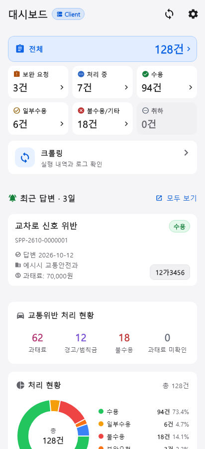
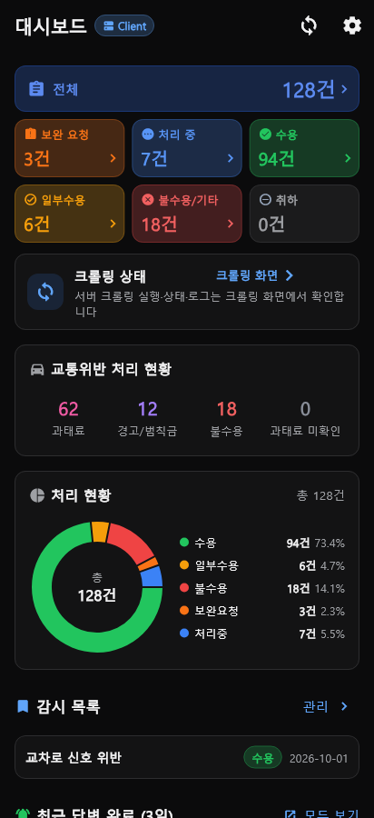
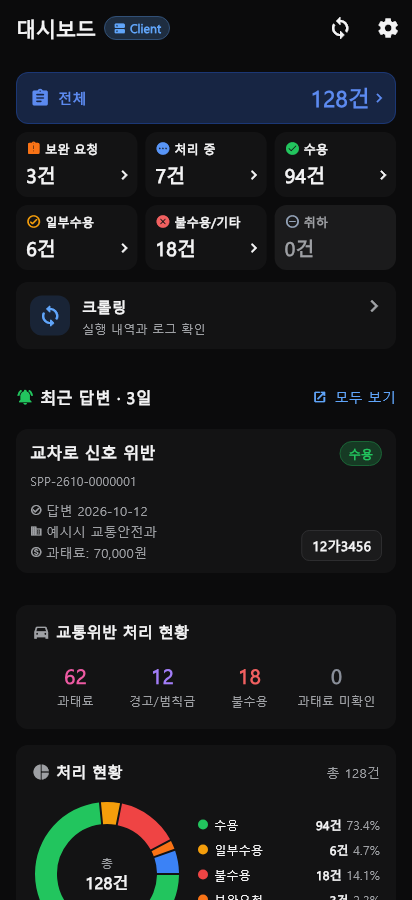
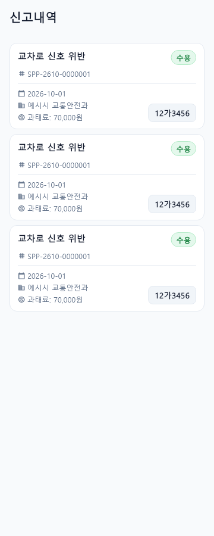
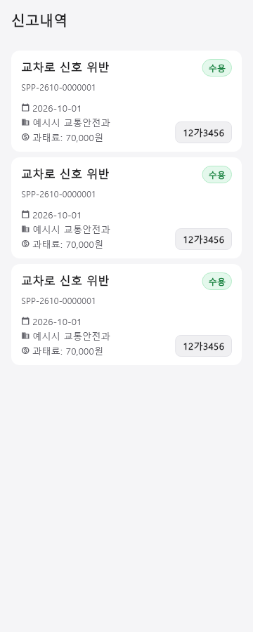
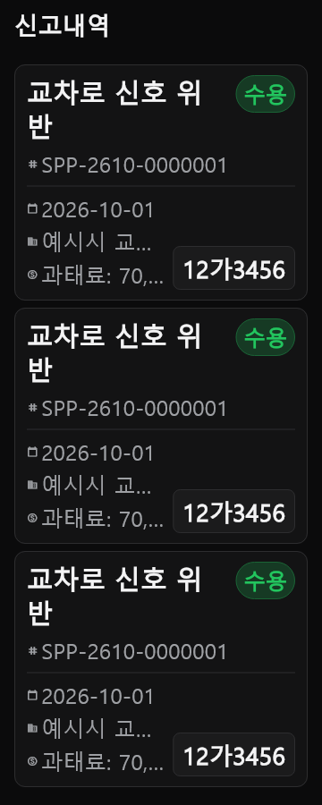
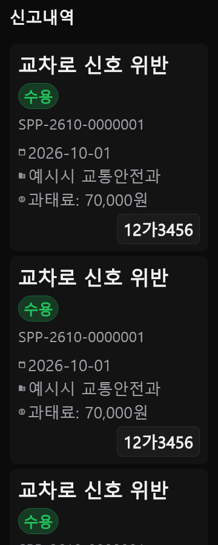

# Neutral UI refresh — verification

Base: `64d440f0a8022cbcb49928c08ed8e18381a9e7fc` · Branch: `ui/neutral-refresh`.

## Implemented

- Neutral light surfaces, existing neutral dark palette, shared typography, borderless default cards, 48dp default buttons, and restrained blue emphasis. The shared theme reaches onboarding, filters, management, statistics, maps, notifications, settings, and recovery without replacing their behaviors.
- Dashboard status tiles use neutral surfaces with semantic icons. Recent answers follow sync status and reuse the report card. Report date/manager remain in detail; the preview prioritizes answer date, agency, disposition, report number, and plate.
- Report headers reflow on narrow/large-text layouts. Metadata wraps; plates move below metadata above 1.3× text scale. Selection, status, supplement information, and confirmed/estimated amounts remain distinct.
- Concise Korean labels across setup, sync, settings, and detail. Backup-location help expands on demand. Existing settings sections, notices, source links, consent, and destructive-action explanations remain.
- Fixed sync rotation ignoring the system reduced-motion preference. Regression covers switching the preference while synchronization is active.
- Existing selection Back behavior was already implemented through `SelectionBackScope`; its regression tests were retained.

## Results and limitations

| Check | Result |
|---|---|
| Baseline `flutter analyze --no-pub` | PASS: no issues |
| Final `flutter analyze --no-pub` | PASS: no issues |
| Production-configured `flutter test --no-pub` | BLOCKED: no Windows C++ compiler for bundled SQLite native hook |
| Host-adapted baseline full suite | 1,826 passed, 24 skipped, 24 failed |
| Host-adapted final full suite | 1,876 passed, 24 skipped, the same 24 failed; no additional failures |
| Baseline and updated render matrices | PASS: 48 each; Client/Standalone × light/dark × 360/412dp × 1.0/1.3/2.0 × dashboard/report-card previews |
| Existing contrast, tap-target, navigation, selection, keyboard, filter and theme checks | Passed in the host-adapted full suite except the pre-existing environment failures listed below |
| Android native permission, share/file picker, notification, background/resume and physical-device performance checks | NOT_RUN: `adb devices -l` empty; `flutter emulators` reports no emulator sources |
| Approved Linux golden comparisons | Skipped: required Linux Noto font unavailable; existing golden files unchanged |

Host: Windows, Flutter 3.47.6 / Dart 3.13.5 (repository pins Flutter 3.47.5). `flutter pub get` also reported missing Windows symlink support; package resolution completed and analyze/tests were invoked with `--no-pub`.

For the host-adapted tests only, the SQLite hook was temporarily set to `source: system`, loading the installed Python SQLite 3.50.4 DLL through PATH. The original `pubspec.yaml` was restored after each run; dependencies and the production SQLite configuration are unchanged. These results do **not** validate the bundled SQLite 3.53.4 build. Existing failures include Windows rename/lock/path behavior, CRLF-sensitive contract hashes, platform build checks, and the substitute SQLite version. The exact failed-test sets are identical: [baseline](evidence/2026-10-14-neutral-refresh/baseline-failures.txt), [final](evidence/2026-10-14-neutral-refresh/final-failures.txt).

Screenshots use synthetic reports, Windows Malgun for Korean and the Flutter Material icon font. The capture harness explicitly supplies the Korean font to AppBar titles; production uses system fonts. These are real Flutter widget renders, not emulator screenshots. Dashboard renders exercise the actual screen; report renders exercise the shared cards in a simple preview scaffold. Full app navigation, all secondary screens and native behavior are not claimed as visually verified. Complete local logs and 96 renders are under `.ui-evidence/` (excluded from Git).

## Before / after

| | Before | After |
|---|---|---|
| Light dashboard |  |  |
| Dark dashboard |  |  |
| Report cards |  |  |
| Large text |  |  |

## Issue #8 — investigated, unresolved

[Issue #8](https://github.com/Fentanest/safetyreport-mobile/issues/8) reports missing estimates for disabled-parking answers referencing articles 90/17 and answers without those phrases. Inspection of `fine_estimate.dart` shows two separate paths:

1. `classify` recognizes the structured `EP-01` subtype as disabled parking. It does not use article-17/90 text as a disabled-parking fallback. Parking records without the subtype can fall into the general parking rule.
2. `isEstimateTarget` requires `범칙금_과태료` to contain `과태료` and have no parseable confirmed amount. A blank disposition is intentionally excluded before classification.

The [official statute](https://www.law.go.kr/lsEfInfoP.do?lsiSeq=267429) and its [fine schedule](https://www.law.go.kr/LSW/flDownload.do?bylClsCd=110201&flSeq=99003695&gubun=) distinguish specific prohibited conduct. Bare article numbers, absent disposition text, or an unverified answer cannot safely establish that conduct. No fine rule or database value was changed. The attached personal backup was not downloaded; affected-record reproduction remains unverified. A follow-up needs sanitized records with subtype codes, full law/answer text, and disposition, plus matching server/client fixtures before changing classification or eligibility.

## Reproduce UI captures

With the repository's supported native compiler and dependency setup, set `SR_REFRESH_RENDER_OUT` to an output directory, `SR_RENDER_FONT` to a Korean font file, and `FLUTTER_ROOT` to the Flutter SDK. Run `flutter test --no-pub test/tool/neutral_refresh_render_test.dart`. The tool does not overwrite approved goldens. Without the output variable, its 48 capture cases skip normally.
