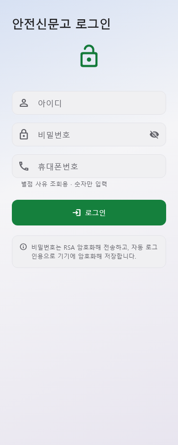
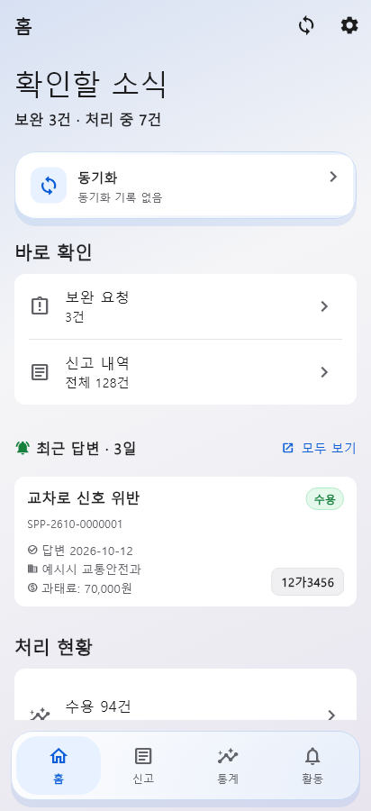
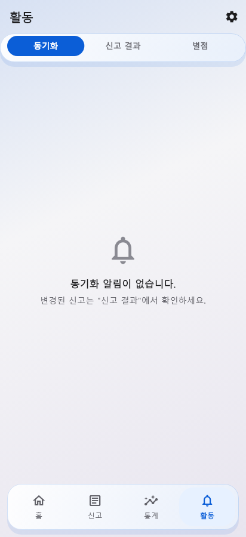
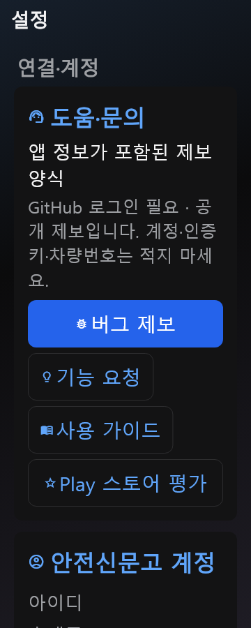

# Standalone-only verification

Production entry: `main()` → `ReportProvider.standaloneOnly()`. Server setup and mode switching are removed. Legacy adapters remain for DB import compatibility and regression tests; they are not exposed as a second app mode. Community account/consent services remain required independently of the removed PC server connection.

Client upgrades retain URL/key, pending file imports and local databases. Previous direct-login username/phone are archived under `legacy_client_` and removed from active preferences, requiring fresh login. Existing Standalone/demo accounts remain unchanged. Native Client gate admission, renewal, server shortcuts and Client notification work are blocked before Flutter migration too.

Copy checks cover login, settings, permissions, activity, sync, report details, management and recovery. Repeated mode/connection descriptions are removed. Consent, data-loss/recovery warnings, source attribution, public-issue privacy notices and confirmed/estimated amounts remain explicit.

| Check | Result |
|---|---|
| Flutter analysis | No issues |
| Host-adapted full suite | 1,843 passed; 132 skipped; exactly the same 24 recorded baseline failures; no added failures |
| Migration coverage | Client upgrade preserves recovery preferences/imports; no stale direct login; idempotent preparation; existing Standalone/demo unchanged; server configuration rejected; reset stays Standalone |
| UI/auth coverage | Login retains consent/permission gate and demo path; account recovery cannot return to modes; authentication completion after unmount is safe; no mode-switch entry |
| Flutter render matrix | 108 passed: Standalone × 2 themes × 360/412dp × scales 1/1.3/2 × 9 surfaces |
| Native unit test | NOT_RUN: Android directory has no Gradle wrapper; Java/Gradle unavailable; configured SDK path is Platform Tools only |
| Device behavior | NOT_RUN: no emulator/device; native Kotlin changes still require Android build and device verification |
| Whitespace/dependencies | Clean diff check; production pubspec and lock unchanged |

132 skips include 108 opt-in render cases, executed separately. Host tests temporarily used Python SQLite 3.50.4 because the Windows compiler for the production source hook is unavailable; original production configuration was restored. Baseline failures concern existing Windows file/lock/path, CRLF contract hashes, and native SQLite build/version checks. Full logs are `.ui-evidence/standalone-verified-test.log`, `.ui-evidence/standalone-final-analyze.log`, and `.ui-evidence/standalone-render.log`.

These are synthetic Flutter widget captures, not Android screenshots. The nine surfaces are Home, report-card preview, detail, Reports workspace, management, Activity, settings, setup and Insights loading/error shell. Populated native charts, all secondary states, Android permissions/sharing/background behavior and native service shutdown are not established by these captures.

| Direct login | Home |
|---|---|
|  |  |

| Activity | Settings at 2× text |
|---|---|
|  |  |
